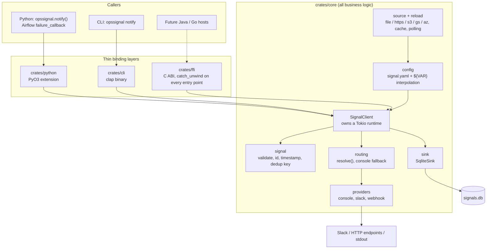
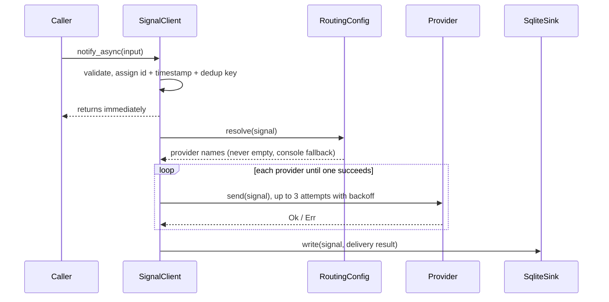

# Architecture

This document records the design decisions for opssignal and the trade-offs
behind them. If you're implementing a new provider, sink, or binding, read
this first.

## Components



The Python and FFI bindings each hold one process-global `SignalClient`,
built lazily from `signal.yaml` on the first call. The CLI builds one per
invocation.

### Lifecycle of one signal



`notify_sync` runs the same steps but blocks the caller until the result is
known or the timeout expires.

## Signal model

```rust
pub struct Signal {
    pub id: Uuid,              // core-generated, never caller-supplied
    pub source: String,
    pub event_type: String,
    pub severity: Severity,    // closed enum, not a free string
    pub title: String,
    pub message: Option<String>,
    pub environment: Option<String>,
    pub metadata: serde_json::Value,
    pub timestamp: DateTime<Utc>,  // core-stamped
    pub dedup_key: Option<String>, // computed if caller omits it
    // ...
}
```

`id` and `timestamp` are always core-generated. Every downstream component
(sink, dedup, retry tracking) needs a stable identity and ordering guarantee
that doesn't depend on every language binding remembering to set these
correctly.

## Delivery semantics: sync vs async

Both `notify_sync` and `notify_async` share one internal pipeline
(validate → route → deliver → record). The only difference is whether the
calling thread blocks on the delivery future.

**Default for the Airflow adapter is async (fire-and-forget).** A blocking
call on a flaky Slack webhook inside an `on_failure_callback` would add
latency and a new failure mode to the very DAG run being monitored. Callers
who want a delivery guarantee can call `notify_sync` directly with an
explicit timeout.

The design rule is that persistence to the sink happens **before** delivery
is attempted, regardless of sync/async, so a failed delivery is still durably
recorded with `delivery_status: failed`. This is what makes delivery
analytics and MTTR reporting possible later without re-architecting.

> **Not yet implemented.** Today `SignalClient` delivers first and writes the
> sink afterwards, in one step with the delivery result (see the sequence
> above). Failed deliveries are recorded, but a signal still in flight when
> the process exits is lost. Moving the write ahead of delivery is an open
> item.

## The storage boundary

```rust
pub trait SignalSink: Send + Sync {
    fn write(&self, signal: &Signal, result: &DeliveryResult) -> Result<(), SignalError>;
}
```

A sink is a **write-only side effect**, not a queryable API. This SDK does
not expose querying, dashboards, or aggregation — that's explicitly out of
scope for the open-source core (see "what this is not" in the README) and is
the hosted control plane's job, reading from the same SQLite/Postgres file
OSS users already populate.

- **SQLite** is the default sink: zero-config, works out of the box.
- **Postgres / S3** are opt-in for centralized analytics across multiple
  workers — relevant once you outgrow a single-node Airflow deployment,
  since SQLite's single-writer model will start serializing writes under
  concurrent load.

## Routing

Routing config matches signals against rules and resolves to a list of
provider names.

**Invariant: unmatched signals always fall back to the `console` provider.**
A signal that matches no route must never silently disappear — that failure
mode is worse than not having the SDK at all. This is enforced in
`RoutingConfig::resolve`, not left to configuration.

## Config sources and reload

`SIGNAL_CONFIG` can name a local file or an `https://`, `s3://`, `gs://` or
`az://` object (`crates/core/src/source.rs`). The cloud stores sit behind the
`s3`, `gcs` and `azure` cargo features of `opssignal-core`, so the core stays
light. They run on the same reqwest/rustls stack as the providers rather than
pulling in a second one.

Cloud code ships only in cloud packages. The base CLI and C library compile
none of it; their `aws`, `gcp`, `azure` and `all` features build a variant
that is the base plus that cloud. The Python wheel compiles none either:
each cloud ships as its own wheel (`crates/python-aws`, `-gcp`, `-azure`),
installed through the `opssignal[aws]`, `[gcp]` and `[azure]` extras, because
pip extras can add packages but cannot change what is compiled into one. At
startup the base binding imports whichever add-ons are installed and registers
each one's `fetch` with the core (`source::register_fetcher`). The core calls
it on a plain thread for that scheme, with the same cache and fallback rules.
An add-on is a thin wrapper around `source::fetch_blocking`; it has no logic of
its own.

Two reliability rules shape this code:

- **A config source is never a reason to lose a signal.** A remote source that
  is unreachable or serves a broken file falls back to the last good cached
  copy, then to the zero-config default (console only). The cache holds the
  raw text before `${VAR}` substitution, so it never contains secrets.
- **A reload is all or nothing.** `reload.rs` polls the source on an interval
  (default 60 s) and, when the text changes and loads cleanly, swaps routes and
  providers together as one `Pipeline` behind an `RwLock<Arc<_>>`. In-flight
  deliveries keep the `Arc` they started with. A failed reload keeps the
  current pipeline. The sink is never reopened live.

Polling is used instead of filesystem notifications because Kubernetes updates
ConfigMap mounts by swapping a symlink, which file watchers often miss, and
the same loop covers remote sources.

## FFI panic safety

Every `#[no_mangle] extern "C"` function in `crates/ffi` must be wrapped in
`catch_unwind` (see `crates/ffi/src/lib.rs::guarded`). A Rust panic crossing
the FFI boundary is undefined behavior in the host language and can crash
the calling process outright — for an embedded SDK, that's worse than the
failure it was supposed to report on.

The Python bindings (`crates/python`) additionally translate `Result::Err`
into real Python exceptions via PyO3 — never a silently swallowed `None`.

## Why two separate Rust crates for bindings (`ffi` vs `python`)

`crates/ffi` is a generic C ABI layer intended for future Java/Go bindings
via JNI/cgo. `crates/python` uses PyO3 macros directly, which is a different
(and for Python, more idiomatic and lower-overhead) binding mechanism than
hand-rolled C ABI. Both wrap the same `opssignal-core` logic; neither contains
business logic of its own.

## What's deliberately out of scope (v0.1)

- Event bus / message queue semantics
- Event sourcing, complex event processing
- Long-running workflow orchestration
- Java and Go bindings (designed for, not built — see roadmap in README)
- Querying/dashboards over stored signals (hosted control plane territory)

## Revisit triggers

| Decision | Revisit when |
|---|---|
| Embedded Tokio runtime | If embedding conflicts with host apps that have their own async runtime become common |
| SQLite default sink | When users run multi-worker Airflow and need unified cross-worker history |
| No bounded buffering/backpressure | If burst scenarios (thousands of signals in a tight loop) overwhelm provider rate limits |
| Hash-based dedup | If semantically-identical-but-textually-different signals need correlation (likely an AI-correlation premium feature, not OSS core) |
