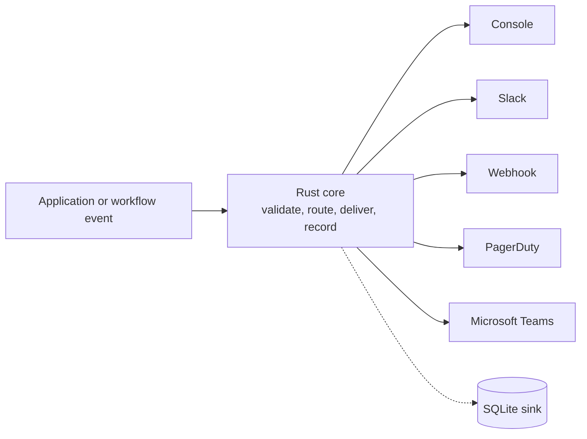

# OpsSignal

A Rust-powered SDK for turning application and workflow events into structured,
routed operational notifications: Slack, webhooks, and more, from a single
event model.

!!! warning "Status: beta (latest release v1.0.0-beta.1)"
    Config keys, the Python API and the SQLite schema may still change before
    1.0.0. The most-tested integration targets are **Airflow** and **dbt**,
    via the Python bindings. The CLI and a C ABI (for future Java/Go
    bindings) exist but are young.

!!! info "Which release has which feature"
    These pages describe the current `main` branch. Everything shipped in
    v1.0.0-beta.1 unless the section says otherwise: features added later
    carry an **"Added in"** note naming the release that brings them.
    See [Releases](changelog.md) for what changed in each version.

## What it does

Existing tools solve parts of this problem. Alertmanager routes alerts but
isn't an embeddable application SDK, Airflow callbacks are Python-only, and
Slack or Teams SDKs are provider-specific. OpsSignal combines a shared Rust
core, a common signal model and a provider abstraction, so the same routing
and retry logic behaves the same way from every calling language.

## What it is not

OpsSignal is **not** an event bus, message queue or workflow orchestrator. It
does not do event sourcing, complex event processing or long-running
scheduling. It sits downstream of those systems and turns their events into
notifications.

## Where to go next

- [Getting started](getting-started.md): install, send a first signal from Python or the CLI.
- [Configuration](configuration.md): `signal.yaml`, providers, routes, storage.
- [Providers](providers.md): Slack, Teams, PagerDuty, webhook and console.
- [CLI](cli.md): flags and exit codes for shell and CI use.
- [Architecture](ARCHITECTURE.md): components, delivery semantics, design rules.
- [API reference](reference.md): generated Rust docs for `opssignal-core`.
- [Releases](changelog.md): what changed in each version.

## Roadmap

| Release | Scope |
|---|---|
| v1.0.0-beta.1 (released) | Rust core, Console/Webhook/Slack/PagerDuty/Teams/Opsgenie/Email providers, SQLite sink, Python bindings, Airflow and dbt adapters, CLI, C ABI |
| Next beta | Fan-out delivery mode for routes |
| Later | Dedup, retry/backoff tuning, Alertmanager provider; Postgres sink; Dagster + Prefect adapters |
| Only on demand | Java/Go bindings, only if real external demand appears |

## License

Apache-2.0, with no contributor agreement. See
[LICENSE](https://github.com/adithyapathipaka/OpsSignal/blob/main/LICENSE).
